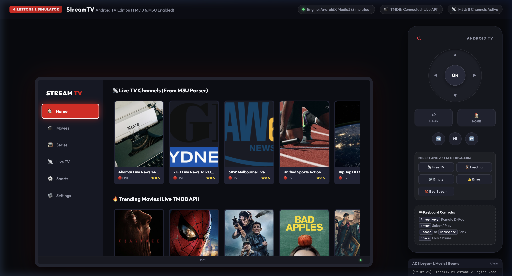
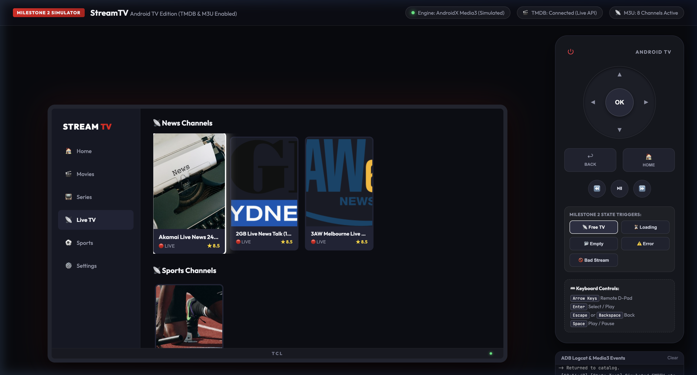
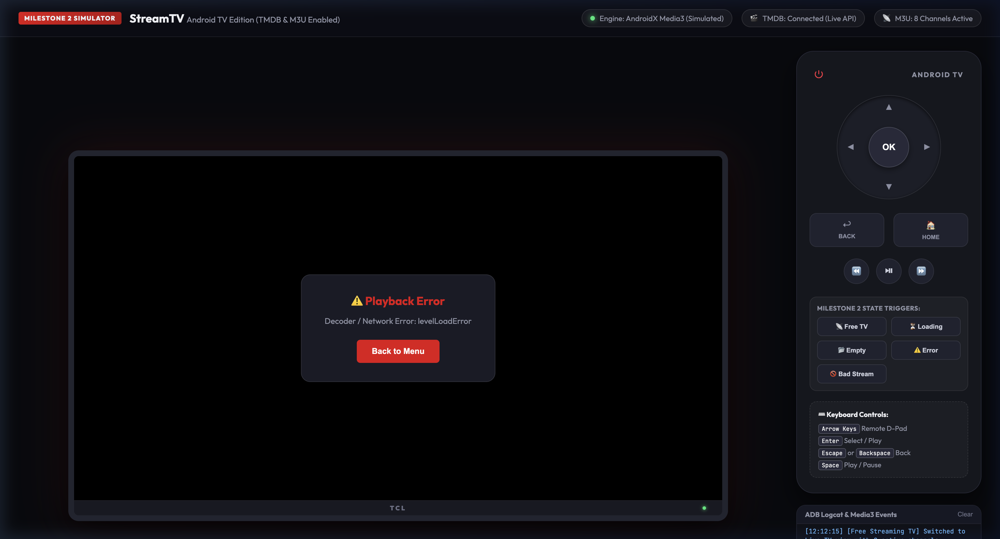
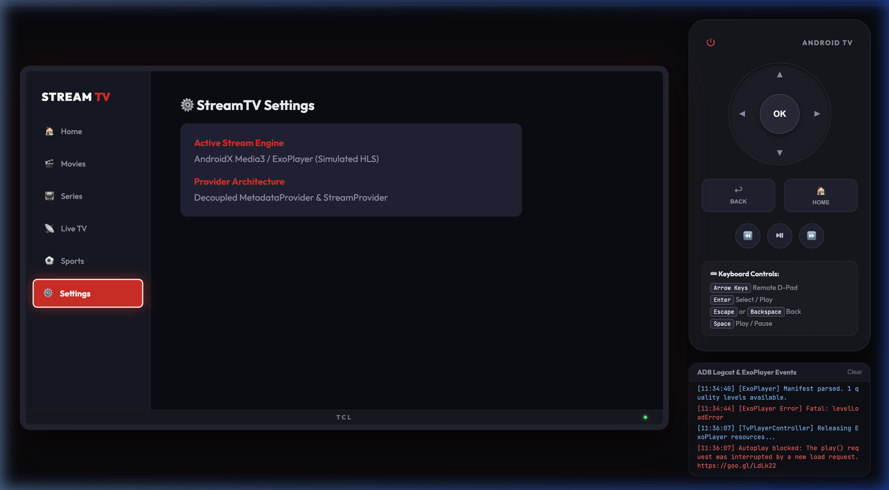

# StreamTV (Android TV)

A native Android TV streaming application built with **Kotlin**, **Jetpack Compose for TV**, and **AndroidX Media3 (ExoPlayer)**.

StreamTV supports movies, TV series, and live television feeds through decoupled metadata and streaming providers, featuring full 10-foot D-Pad navigation, remote key bindings, and resilient state handling.

---

## Screenshots & Demo

| 🏠 Home Screen (TMDB Live Discovery) | 📡 Live TV & Sports Channels |
| :---: | :---: |
|  |  |
| *Trending Movies & Series powered by TMDB API with real ratings & posters* | *Free Live TV & Sports Feeds with multi-bitrate HLS streams* |

| 📺 Media3 (ExoPlayer) Playback & Remote HUD | ⚙️ Providers & Streaming API Settings |
| :---: | :---: |
|  |  |
| *ExoPlayer HLS/AVC playback with 🔴 LIVE indicator and playback telemetry* | *One-touch Free Streaming TV feeds & TMDB API key configuration* |

---

## Architecture Overview

```text
StreamTV/
├── app/                  # Android TV Application (Leanback UI, TV Navigation, Player HUD)
├── core/
│   ├── model/           # Typed MediaItem, ContentType, StreamResult models
│   ├── player/          # Media3 ExoPlayer wrapper & D-Pad remote controller
│   └── network/         # Coroutine HTTP client supporting remote & local files
└── providers/
    ├── api/             # MetadataProvider & StreamProvider interfaces
    ├── demo/            # Known-good test streams & fallback catalog
    ├── metadata-tmdb/   # TheMovieDatabase (TMDB) discovery, search, genres & posters
    └── live-tv-m3u/     # Free Live TV streaming APIs, M3U parser & EPG attributes
```

### Key Principles

1. **Decoupled Metadata vs Playback**:
   - `MetadataProvider`: Fetches titles, overviews, ratings, genres, and posters (e.g., TMDB).
   - `StreamProvider`: Resolves playable media URLs (`.m3u8`, `.mpd`, direct stream).
2. **Typed Media Models**:
   - `MediaItem` stores `id`, `title`, `overview`, `posterUrl`, `contentType` (`MOVIE`, `SERIES`, `LIVE_TV`, `SPORTS`), season/episode numbers, and M3U metadata (`groupTitle`, `tvgId`, `tvgLogo`).
3. **10-Foot TV Experience**:
   - Every surface is optimized for D-Pad focus with high-contrast borders and subtle scaling.
   - Remote control support:
     - `DPAD_CENTER` / `SPACE`: Toggle Play / Pause
     - `DPAD_RIGHT`: Fast-Forward +10 seconds
     - `DPAD_LEFT`: Rewind -10 seconds
     - `BACK`: Close player and release resources cleanly
4. **State Management**:
   - Explicit Handling for **Loading**, **Empty**, **Error with Retry**, and **Invalid Stream** states across all screens.
5. **Free Streaming APIs for Live TV**:
   - Curated public domain & Free-To-Air channels (Global News, Live Sports, Cinema, Science & Tech, English FTA).
   - Auto-initialization with verified 24/7 public broadcast feeds so live channels work out of the box.
6. **Compliance & Safety**:
   - No DRM bypass, no scraping of subscription services, and no unauthorized copyrighted streams are bundled.

---

## Configuration

### 1. TMDB API Key Setup
To enable real TMDB movie and TV discovery:
1. Register for a free API key at [themoviedb.org](https://www.themoviedb.org/settings/api).
2. Copy `local.properties.example` to `local.properties`:
   ```bash
   cp local.properties.example local.properties
   ```
3. Set your API key in `local.properties`:
   ```properties
   tmdb.api.key=your_tmdb_api_key_here
   ```
   *(Alternatively, export the environment variable: `export TMDB_API_KEY="your_key"`)*
4. `local.properties` is explicitly ignored by git to keep your private key out of source control.
5. If unconfigured, StreamTV automatically falls back to the demo catalog with clear configuration status in **Settings**.

### 2. Free Streaming APIs & M3U Live TV
StreamTV includes built-in connectors for free public live TV feeds and custom playlists:
* **Built-in Free Live TV Feeds:**
  - 📰 **Global News 24/7:** Akamai Global News, 2GB Live News Talk, 3AW Live News
  - ⚽ **Live Sports:** Unified Sports Action 1080p, Extreme Athletics
  - 🎬 **Movies & Cinema:** 24/7 Classic Cinema & Short Films
  - 🚀 **Science & Tech:** Apple BipBop Multi-Bitrate HD, Space & Tech Feeds
  - 🌐 **IPTV-org Public APIs:** News, Sports, Movies, Science, and English Free-To-Air feeds
* **Custom Playlists:**
  - Set any remote HTTP/HTTPS `#EXTM3U` playlist URL.
  - Load local playlist files (`file:///storage/emulated/0/Download/channels.m3u`).
  - Supports `#EXTINF` directives, `tvg-id`, `tvg-name`, `tvg-logo`, `group-title`, and custom HTTP headers.

---

## Interactive 10-Foot Web Simulator

StreamTV includes a standalone, browser-based Android TV simulator located in `simulator/`:

* **Live URL:** `http://localhost:8080/`
* **Run locally:**
  ```bash
  cd simulator
  python3 -m http.server 8080
  ```
* **Features:**
  - Realistic 10-foot Leanback TV UI with 55-inch TCL bezel.
  - Interactive D-Pad remote control (Arrow Keys, Enter/OK, Back, Home, Play/Pause).
  - Real Hls.js video player executing adaptive `.m3u8` live streams with TV Remote HUD.
  - Direct TMDB API connection fetching live trending movies, series, and high-res posters.
  - Milestone 2 State Triggers: Instant simulation of **Loading**, **Empty**, **Error with Retry**, and **Invalid Stream** states.

---

## Running Unit Tests

To run the unit test suite verifying TMDB response parsing, M3U playlist parsing, Free Live TV feeds, and provider error resolution:

```bash
export JAVA_HOME=/opt/homebrew/opt/openjdk@17
./gradlew test
```

Specific test classes:
* `TmdbResponseParserTest`: Validates trending movies, TV shows, genres, pagination, and error responses.
* `M3uParserTest`: Validates playlist parsing, channel group attribution, directive headers, malformed entries, and stream resolution errors.
* `FreeLiveTvApiTest`: Validates free streaming categories, verified default channels, and auto-initialization.

---

## Building and Running the App

### In Android Studio
1. Launch **Android Studio**.
2. Click **Open** and select the `StreamTV` directory.
3. Allow Gradle to sync.
4. Select an **Android TV (1080p or 4K)** device or emulator.
5. Click **Run (`Shift + F10`)**.

### Command Line (ADB)
```bash
export JAVA_HOME=/opt/homebrew/opt/openjdk@17
./gradlew assembleDebug
adb install -r app/build/outputs/apk/debug/app-debug.apk
adb shell monkey -p com.streamtv.app -c android.intent.category.LAUNCHER 1
```

---

## License

This project is licensed under the MIT License - see the [LICENSE](LICENSE) file for details.
